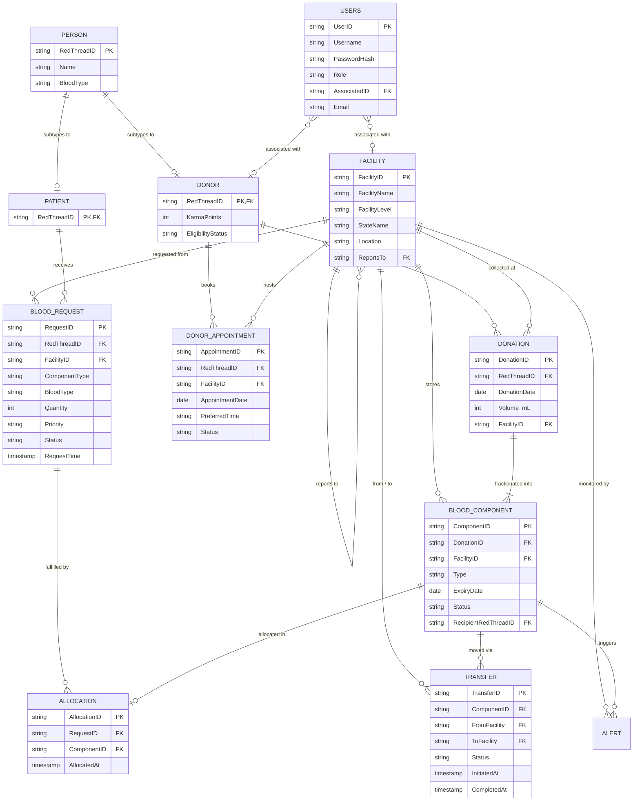
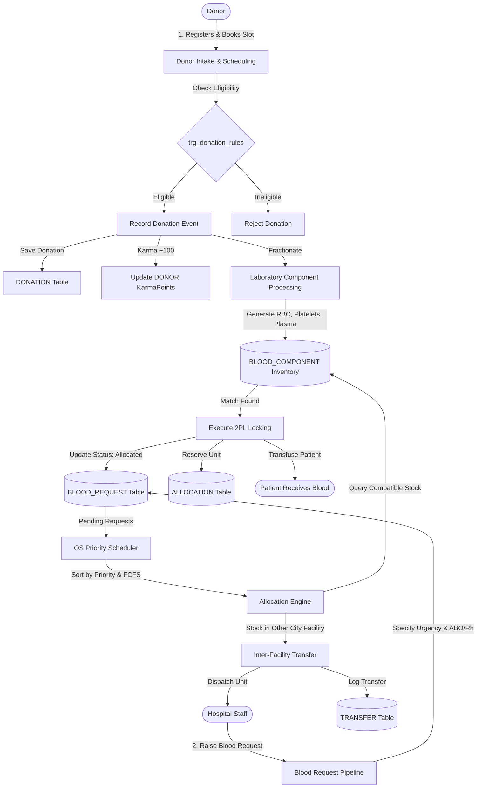
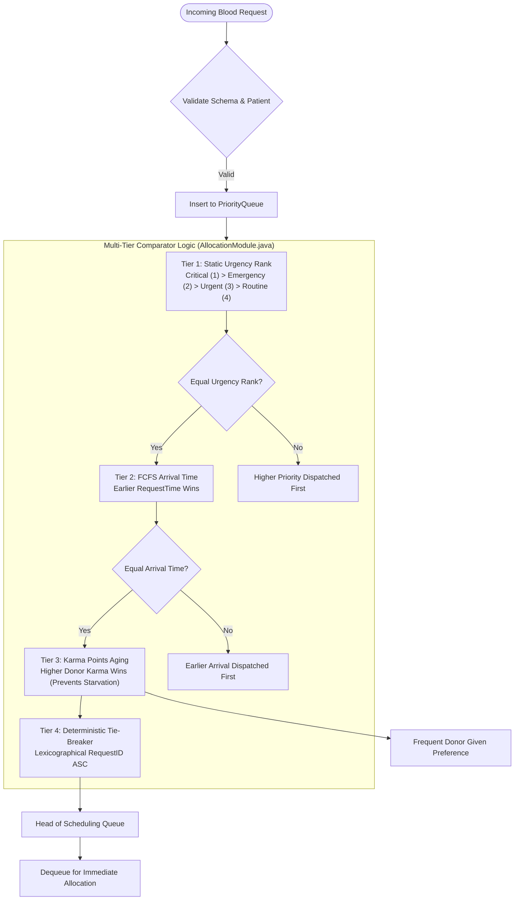
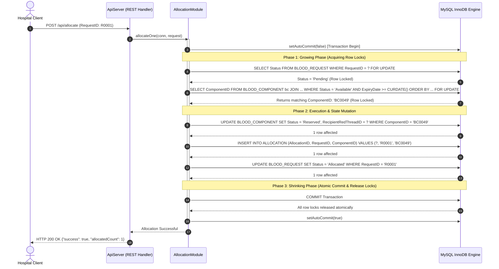
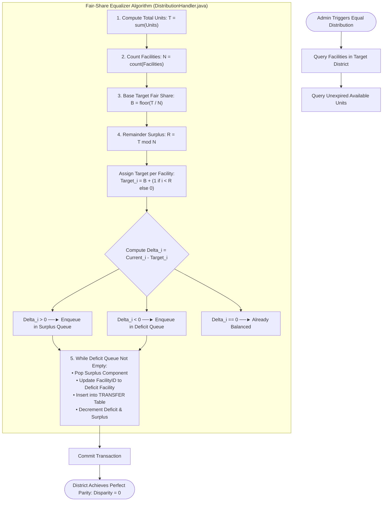
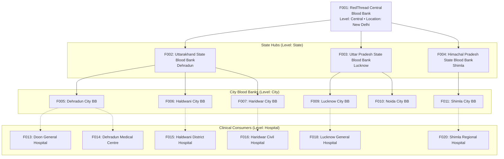
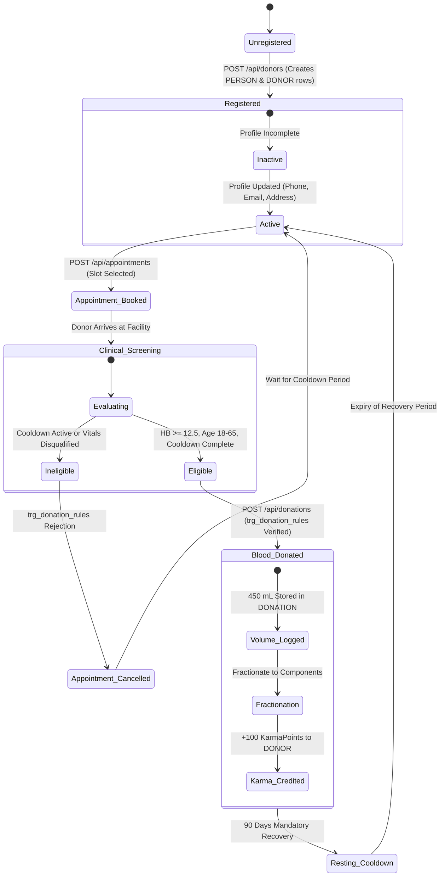
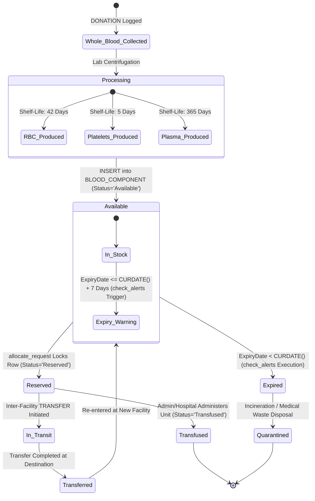

# RedThread: Complete System Diagrams & Flow Architecture

> **Document Type:** Comprehensive Architecture, Database, & OS Algorithms Reference  
> **Format Specification:** Optimized for **A4 Sheet Printing & PDF Export**  
> **Course:** B.Tech OSDBMS-V-2026 • Team Last_Of_Us (`#OSDBMS-V-2026-T071`)  
> **Project:** RedThread — Blood Bank Management System

---

<style>
  @media print {
    @page {
      size: A4 portrait;
      margin: 12mm 15mm 15mm 15mm;
    }
    body {
      font-size: 11pt;
      line-height: 1.35;
      color: #111827;
      background: #ffffff;
    }
    .a4-page {
      page-break-after: always;
      page-break-inside: avoid;
      min-height: 255mm;
      padding-top: 5mm;
    }
    .a4-page:last-child {
      page-break-after: auto;
    }
    .mermaid {
      page-break-inside: avoid;
      max-width: 100% !important;
      margin: 10px auto;
    }
    h1, h2, h3 {
      color: #991b1b !important;
      page-break-after: avoid;
    }
    table {
      page-break-inside: avoid;
      width: 100%;
      border-collapse: collapse;
      font-size: 9.5pt;
    }
    th, td {
      border: 1px solid #d1d5db;
      padding: 5px 8px;
    }
    th {
      background-color: #f3f4f6 !important;
      -webkit-print-color-adjust: exact;
      print-color-adjust: exact;
    }
  }

  .a4-page {
    border-bottom: 2px dashed #e5e7eb;
    margin-bottom: 40px;
    padding-bottom: 30px;
  }
  .page-header {
    display: flex;
    justify-content: space-between;
    align-items: center;
    border-bottom: 2px solid #991b1b;
    padding-bottom: 6px;
    margin-bottom: 16px;
  }
  .page-header span {
    font-size: 9pt;
    color: #6b7280;
    text-transform: uppercase;
    letter-spacing: 0.05em;
    font-weight: 600;
  }
  .badge {
    background-color: #fee2e2;
    color: #991b1b;
    padding: 2px 8px;
    border-radius: 4px;
    font-size: 8.5pt;
    font-weight: bold;
  }
</style>

---

<div class="a4-page">
<div class="page-header">
  <span>RedThread Architecture • OSDBMS Final</span>
  <span class="badge">A4 Sheet 1 of 10</span>
</div>

# Sheet 1: 5-Tier Layered System Architecture

RedThread integrates a decoupled multi-tiered architecture separating client presentation, REST routing, operating system resource scheduling, ACID transactions, and normalized relational storage.

```mermaid
flowchart TD
    subgraph Presentation["Tier 1: Presentation Layer (React 19 + Vite)"]
        UI_Admin["Admin Panel<br/>(Distribution, Audits, Users)"]
        UI_Hosp["Hospital Panel<br/>(Requisitions, Local Inventory)"]
        UI_BB["Blood Bank Panel<br/>(Donations, Storage, Alerts)"]
        UI_Donor["Donor Panel<br/>(Appointments, Profile, Karma)"]
    end

    subgraph Transport["Network & Communication"]
        HTTP_Bridge["RESTful JSON over HTTP / CORS Gateway<br/>(Port 8080 & Reverse Proxy Port 5173)"]
    end

    subgraph Application["Tier 2: Application Layer (Java JDK Built-in)"]
        Router["HttpServer Request Router"]
        Handlers["REST Controllers & JSON Serialization Engine<br/>(Auth, Inventory, Requests, Donors, Transfers, Settings)"]
    end

    subgraph OS_Layer["Tier 3: OS Algorithm Engine"]
        Priority_Engine["Multi-Level Priority Queue Scheduler<br/>(Critical > Emergency > Urgent > Routine)"]
        Lock_Manager["Pessimistic Mutex & 2PL Manager<br/>(Row-level SELECT FOR UPDATE)"]
        Deadlock_Guard["Havender Resource Orderer<br/>(Strict Ascending Key Ordering)"]
        Fair_Balancer["Min-Max Fair-Share Load Balancer<br/>(District Blood Parity Engine)"]
    end

    subgraph Persistence["Tier 4 & 5: Data Access & MySQL Storage"]
        JDBC["Connection-Pooled JDBC Driver"]
        DB[("MySQL 8.0 Engine: redthread_db<br/>14 Normalized Tables • B-Tree Indexes • Triggers • SPs")]
    end

    Presentation --> HTTP_Bridge
    HTTP_Bridge --> Router
    Router --> Handlers
    Handlers --> OS_Layer
    OS_Layer --> JDBC
    JDBC --> DB
```



### Architectural Responsibilities

| Tier | Component | Core Responsibility |
| :--- | :--- | :--- |
| **Presentation** | React 19 Client SPA | Responsive dashboards, real-time input masking, session management via `localStorage`. |
| **Application** | Java `HttpServer` (No Spring) | Zero-dependency high-throughput REST dispatch, request validation, JSON serialization. |
| **OS Layer** | Concurrency Engine | Priority queue triage, thread mutual exclusion, starvation mitigation, and district load balancing. |
| **Data Access** | JDBC Prepared Statements | Connection pooling, transaction boundaries (`setAutoCommit(false)`), and rollback execution. |
| **Storage** | MySQL InnoDB | Relational integrity, foreign key cascades, triggers (`trg_donation_rules`), and procedures. |

</div>

---

<div class="a4-page">
<div class="page-header">
  <span>Entity-Relationship Model • 14 Tables</span>
  <span class="badge">A4 Sheet 2 of 10</span>
</div>

# Sheet 2: Complete Relational ER Diagram

RedThread's database schema is normalized to 3NF/BCNF, enforcing strict referential integrity across 14 tables.



</div>

---

<div class="a4-page">
<div class="page-header">
  <span>System Data Flow • Clinical Pipeline</span>
  <span class="badge">A4 Sheet 3 of 10</span>
</div>

# Sheet 3: End-to-End Clinical Data Flow (DFD Level-1)

This flow illustrates the complete lifecycle from donor arrival to hospital transfusion and inter-facility transfer.



### Critical Flow Control Points

1. **Eligibility Gatekeeper:** Database trigger `trg_donation_rules` rejects any intake if donor has not completed the required resting interval or is marked ineligible.
2. **Fractionation Pipeline:** A single whole blood donation ($450\text{ mL}$) yields 3 independent components with distinct lifespans: Packed RBC ($42\text{ days}$), Platelets ($5\text{ days}$), and Fresh Frozen Plasma ($365\text{ days}$).
3. **Automated Triage:** When emergency requests are submitted, the OS scheduler immediately preempts non-critical queues.

</div>

---

<div class="a4-page">
<div class="page-header">
  <span>OS Scheduling • CPU Algorithm Analog</span>
  <span class="badge">A4 Sheet 4 of 10</span>
</div>

# Sheet 4: Multi-Level Priority Queue & Aging Flow

RedThread models blood triage using **Preemptive Multi-Level Priority Scheduling** augmented with **FCFS** and **Karma Aging**.



### Queue Evaluation Rules

$$\text{Rank}(R) = \langle \text{Priority}(R), \; \text{Timestamp}(R), \; -\text{Karma}(R), \; \text{ID}(R) \rangle$$

```
Severity Tier Order:
  [Rank 1] Critical   ──► Imminent loss of life (immediate dispatch)
  [Rank 2] Emergency  ──► Trauma / OT active hemorrhage
  [Rank 3] Urgent     ──► Surgery scheduled within 24 hours
  [Rank 4] Routine    ──► Thalassemia / Planned elective procedures
```

- **Aging / Anti-Starvation Mechanism:** In pure priority scheduling, `Routine` requests can starve indefinitely if `Emergency` orders keep arriving. RedThread checks the patient/donor's `KarmaPoints`: routine requests from active donors gain priority over uncommitted routine requests.

</div>

---

<div class="a4-page">
<div class="page-header">
  <span>Concurrency Control • 2-Phase Locking</span>
  <span class="badge">A4 Sheet 5 of 10</span>
</div>

# Sheet 5: Pessimistic 2PL Allocation Sequence

To eliminate race conditions (two hospitals claiming the same unit simultaneously), RedThread implements **Strict Two-Phase Locking (2PL)** with row-level locks.



### ACID Invariants Enforced
- **Isolation:** `SELECT ... FOR UPDATE` ensures no concurrent worker can read or mutate `'BC0049'` while the transaction is open.
- **Atomicity:** If inventory matching fails or a connection drops before step 13, `ROLLBACK` executes, restoring all rows to their original states.

</div>

---

<div class="a4-page">
<div class="page-header">
  <span>Deadlock Avoidance • Havender's Ordering</span>
  <span class="badge">A4 Sheet 6 of 10</span>
</div>

# Sheet 6: Deadlock Prevention via Global Ordering

RedThread eliminates Coffman's **Circular Wait Condition** during multi-unit allocations using **Havender's Resource Ordering Principle**.

```mermaid
flowchart TD
    subgraph Problem["Deadlock Scenario (Unordered Locking)"]
        T1["Thread 1 (Hospital A)<br/>Needs {BC0010, BC0025}"]
        T2["Thread 2 (Hospital B)<br/>Needs {BC0025, BC0010}"]
        
        R1[("Component BC0010")]
        R2[("Component BC0025")]
        
        T1 -->|Locks| R1
        T2 -->|Locks| R2
        R1 -.->|T2 Waits For| T2
        R2 -.->|T1 Waits For| T1
        
        DeadlockNote["CIRCULAR WAIT DEADLOCK!<br/>Both threads blocked indefinitely."]
    end

    subgraph Solution["RedThread Solution (Havender's Strict Ascending Order)"]
        Order_Rule["Rule: Always sort resource IDs ascending before acquisition:<br/>ID_1 < ID_2 < ID_3 ..."]
        
        HT1["Thread 1 Request:<br/>{BC0025, BC0010}"]
        HT2["Thread 2 Request:<br/>{BC0025, BC0010}"]
        
        Sort1["Collections.sort() ──► [BC0010, BC0025]"]
        Sort2["Collections.sort() ──► [BC0010, BC0025]"]
        
        HT1 --> Sort1
        HT2 --> Sort2
        
        LockStep1["Step 1: Thread 1 acquires BC0010 first."]
        LockStep2["Step 2: Thread 2 blocked on BC0010 (No circular wait)."]
        LockStep3["Step 3: Thread 1 acquires BC0025, completes, commits, releases locks."]
        LockStep4["Step 4: Thread 2 unblocks, acquires BC0010, then BC0025."]
        
        Sort1 --> LockStep1
        LockStep1 --> LockStep2
        LockStep2 --> LockStep3
        LockStep3 --> LockStep4
    end
```



### Mathematical Proof of Deadlock Immunity

1. Let resources be identified by unique natural numbers: $R_1, R_2, \dots, R_m$.
2. Enforce the invariant: *A process holding resource $R_i$ may only request $R_j$ if $j > i$*.
3. Suppose a circular wait cycle exists: $P_1 \to P_2 \to \dots \to P_k \to P_1$.
4. This requires: $R_{P1} < R_{P2} < \dots < R_{Pk} < R_{P1}$, which yields $R_{P1} < R_{P1}$ (a mathematical contradiction).
5. Therefore, **circular wait cannot occur** in RedThread.

</div>

---

<div class="a4-page">
<div class="page-header">
  <span>Load Balancing • Min-Max Fair Sharing</span>
  <span class="badge">A4 Sheet 7 of 10</span>
</div>

# Sheet 7: OS Min-Max Fair Sharing Blood Balancer

RedThread implements an OS-inspired **Min-Max Fair Sharing Resource Balancer** to eliminate geographic blood hoarding between facilities in the same city/district.



### Real-World Dehradun District Balancing Execution

| Facility ID | Facility Name | Facility Type | Pre-Balance Stock | Target Fair Share | Parity Delta | Post-Balance Stock |
| :--- | :--- | :--- | :---: | :---: | :---: | :---: |
| **`F005`** | Dehradun City Blood Bank | Blood Bank | **16 units** | 4 units | $+12$ (Surplus) | **4 units** |
| **`F002`** | Uttarakhand State Blood Bank | State Hub | **0 units** | 4 units | $-4$ (Deficit) | **4 units** |
| **`F013`** | Doon General Hospital | Hospital | **0 units** | 4 units | $-4$ (Deficit) | **4 units** |
| **`F014`** | Dehradun Medical Centre | Hospital | **0 units** | 4 units | $-4$ (Deficit) | **4 units** |

</div>

---

<div class="a4-page">
<div class="page-header">
  <span>Hierarchical Routing • Spanning Tree</span>
  <span class="badge">A4 Sheet 8 of 10</span>
</div>

# Sheet 8: Hierarchical Spanning Tree Transfer Routing

Inter-facility transfers follow a directed acyclic tree structured via the `ReportsTo` self-referential foreign key.



### Escalation Hierarchy & Inter-Process Transfer Protocol

1. **Local Allocation:** A hospital (`F013`) first queries its designated city blood bank (`F005`).
2. **Upstream Escalation:** If city stock is insufficient, the requisition escalates to the state repository (`F002`).
3. **Cross-State Inter-Connect:** If state reserves are depleted, requests route to Central (`F001`), which coordinates cross-state transfers logged in the `TRANSFER` audit table.

</div>

---

<div class="a4-page">
<div class="page-header">
  <span>Donor Lifecycle • State Machine</span>
  <span class="badge">A4 Sheet 9 of 10</span>
</div>

# Sheet 9: Donor Lifecycle & Database Integrity Triggers

The lifecycle of a donor is governed by strict state transitions enforced by database triggers and appointment handlers.



### Database Trigger Integrity Enforcement

```sql
CREATE TRIGGER trg_donation_rules
BEFORE INSERT ON DONATION
FOR EACH ROW
BEGIN
  DECLARE v_status VARCHAR(20);
  SELECT EligibilityStatus INTO v_status FROM DONOR WHERE RedThreadID = NEW.RedThreadID;
  IF v_status IS NULL OR v_status <> 'Eligible' THEN
    SIGNAL SQLSTATE '45000' SET MESSAGE_TEXT = 'Donor is not eligible to donate';
  END IF;
END$$
```

</div>

---

<div class="a4-page">
<div class="page-header">
  <span>Component Lifecycle • Cache Eviction</span>
  <span class="badge">A4 Sheet 10 of 10</span>
</div>

# Sheet 10: Blood Component Lifecycle & FEFO Eviction

Components represent perishable system cache lines. State transitions are monitored by continuous audit routines and expiration procedures.



### Automated Shelf-Life Audit (`check_alerts` Procedure)

```sql
CREATE PROCEDURE check_alerts()
BEGIN
  -- 1. Automatic Eviction of Stale Cache Lines (Expired Stock)
  UPDATE BLOOD_COMPONENT SET Status='Expired'
  WHERE Status='Available' AND ExpiryDate < CURDATE();

  -- 2. Emit Pre-Expiry Warning Alerts (7-day Lookahead)
  INSERT INTO ALERT (FacilityID, ComponentID, AlertType, Message)
  SELECT bc.FacilityID, bc.ComponentID, 'Expiry',
         CONCAT(bc.Type, ' unit ', bc.ComponentID, ' expires on ', bc.ExpiryDate)
  FROM BLOOD_COMPONENT bc
  WHERE bc.Status='Available'
    AND bc.ExpiryDate BETWEEN CURDATE() AND DATE_ADD(CURDATE(), INTERVAL 7 DAY)
    AND NOT EXISTS (SELECT 1 FROM ALERT a WHERE a.ComponentID=bc.ComponentID AND a.AlertType='Expiry');
END$$
```

</div>
